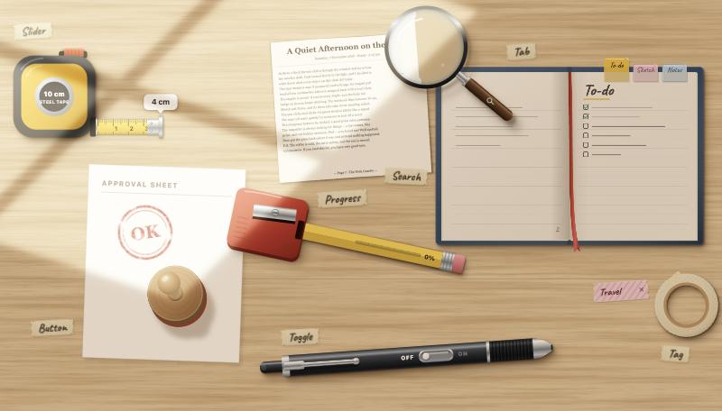
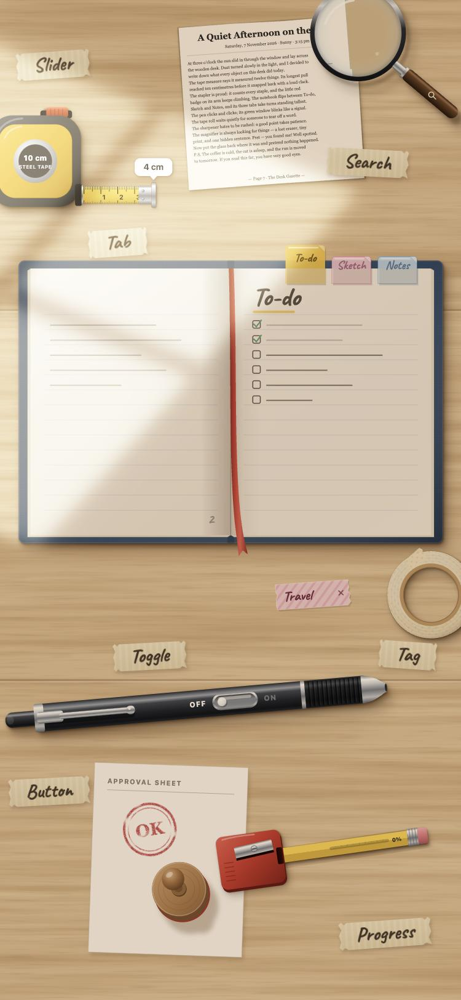

# Stationery UI · 文具组件

A sunlit wooden desk where real stationery behaves like UI components.
Tap and drag the objects. Each one is a working control, with spring physics and synthesized sound.

一张洒满阳光的木桌。桌上的每件文具都是一个能用的 UI 组件。

**Live demo → https://taliaren.github.io/stationary/**

| Desktop | Phone |
| --- | --- |
|  |  |

## The components

| Component | Stationery | How it works |
| --- | --- | --- |
| **Toggle** | Click pen | Tap the pen to click it on or off. You can also drag the switch. The plunger bounces when it locks. |
| **Slider** | Tape measure | Pull the blade out from 0 to 10 cm. It snaps to centimetres with a tick sound, and the value shows in a bubble. |
| **Button** | Rubber stamp | Tap the stamp or the sheet. It stamps straight down, then lifts and moves to another spot on the paper. |
| **Tab** | Notebook with index tabs | Tap a plastic tab and the pages flip to that section. |
| **Tag** | Masking-tape roll | Tap the roll to tear off a strip with a word on it, up to 3. Tap × to peel one off. The roll shrinks as you use it. |
| **Progress** | Pencil sharpener | Twist the pencil to sharpen it from 0 to 100%. Shavings curl out, and the finished pencil is set aside. Tap it to start again. |
| **Search** | Magnifier over a printed slip | Drag the lens over the slip to read the tiny text. One hidden phrase is waiting to be found. |

## Details

- **Mobile-first.** The layout fits one phone screen and fills the window edge to edge on desktop. It switches between a portrait scene and a landscape scene.
- **Input.** Only tap and drag, using pointer events, so mouse and touch both work.
- **Motion.** A small custom spring engine (`src/lib/spring.js`) drives every animation. There are no animation libraries.
- **Sound.** All sounds are made live with the Web Audio API, with no audio files. Their loudness was measured offline and balanced.
- **Light.** One window light from the upper left. Every shadow is cast consistently from that light.
- **Accessibility.** ARIA roles (`switch`, `slider`, `tablist`, `progressbar` …), keyboard support and live-region announcements.

## Run locally

```bash
npm install
npm run dev      # http://localhost:5173
npm run build    # production build in dist/
```

Built with React 18 and Vite 5. Every item is a hand-written SVG component in `src/stationery/`. The positions for both scenes are in `src/stationery/layout.js`.

## Deploy

Every push to `main` builds the site and publishes it to GitHub Pages through `.github/workflows/pages.yml`.
